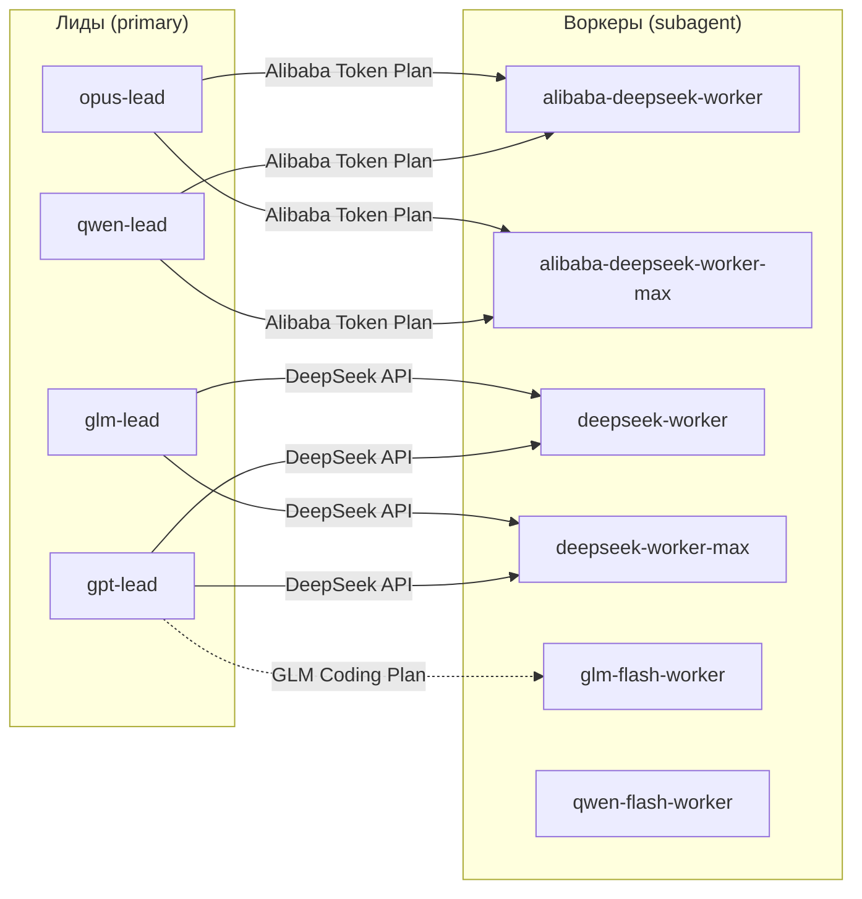

# OpenCode Delegation

Скилл маршрутизации делегирования и набор профилей «лид → воркер» для [OpenCode](https://opencode.ai). Лид планирует, проверяет и принимает результат; воркер выполняет ограниченную задачу — исследование, реализацию и проверки — и возвращает короткий отчёт.

## Что внутри

- **Скилл `delegate-implementation`** — контракт делегирования, правила маршрутизации High/Max, бюджеты, границы разрешений и требования к доказательствам.
- **10 профилей агентов** — 4 лида (`primary`) и 6 воркеров (`subagent`).
- **Пример конфигурации провайдеров** для локальных OpenAI-совместимых прокси.
- **`PROFILES.md`** — автономный русский файл для передачи человеку: таблица, готовые JSON-блоки и инструкция по установке.

## Схема

Маршруты биллинга раздельны: **Alibaba Token Plan** (`alibaba-deepseek-*`, `qwen-lead`, `qwen-flash-worker`), **DeepSeek API** (`deepseek-worker*`), **GLM Coding Plan** (`glm-lead`, `glm-flash-worker`), а также подписка/локальный прокси у `opus-lead`. Не подменяйте один маршрут другим без авторизации.

## Профили

| Профиль | Модель | Режим | Роль |
|---|---|---|---|
| `opus-lead` | `homelab/claude-opus-5-5#high` | primary | Лид: планирование, ревью, приёмка |
| `qwen-lead` | `alibaba-token-plan/qwen3.8-max` | primary | Лид: решения и приёмка |
| `glm-lead` | `zai-coding-plan/glm-5.3` | primary | Лёгкий координатор |
| `gpt-lead` | `openai/gpt-6.1-sol#high` | primary | Лид GPT + DeepSeek |
| `alibaba-deepseek-worker` | `alibaba-token-plan/deepseek-v4.1-flash#high` | subagent | Воркер по умолчанию (Alibaba) |
| `alibaba-deepseek-worker-max` | `alibaba-token-plan/deepseek-v4.1-flash#max` | subagent | Воркер для сложного (Alibaba) |
| `deepseek-worker` | `deepseek/deepseek-flash#high` | subagent | Воркер по умолчанию (DeepSeek API) |
| `deepseek-worker-max` | `deepseek/deepseek-flash#max` | subagent | Воркер для сложного (DeepSeek API) |
| `glm-flash-worker` | `zai-coding-plan/glm-5.3-flash` | subagent | Воркер GLM Coding Plan |
| `qwen-flash-worker` | `alibaba-token-plan/qwen3.8-flash` | subagent | Воркер Qwen3.8 Flash |

**High vs Max одной строкой:** по умолчанию — High; Max только для конкретной сложности (конкурентность, взаимодействующие инварианты, сложные алгоритмы), с указанием причины.

## Установка

1. **Скилл.** Скопируйте `skill/delegate-implementation/` в `~/.agents/skills/` или `~/.config/opencode/skills/`.
2. **Агенты.** Вставьте объект `agents` из `config/agents.json` в `~/.config/opencode/opencode.json` под ключ `"agents"`.
3. **Провайдеры.** `deepseek`, `zai-coding-plan`, `alibaba-token-plan`, `openai` настраиваются через `opencode auth`. Локальные прокси `homelab` и `claude-code` — опционально, по `config/providers.example.json` (замените плейсхолдеры `YOUR-HOMELAB-PROXY` / `YOUR-API-KEY`).
4. **Выбор агента.** Переключите агента в OpenCode (Tab/меню агентов). Воркеров выбирает лид при делегировании.

Подробная русская инструкция с готовыми JSON-блоками — в [`PROFILES.md`](PROFILES.md).

## Файлы

| Путь | Назначение |
|---|---|
| `skill/delegate-implementation/SKILL.md` | Скилл делегирования |
| `skill/delegate-implementation/references/measurements.md` | Исторические заметки об измерениях |
| `config/agents.json` | Объект `agents` для вставки в `opencode.json` |
| `config/providers.example.json` | Санитизированный пример провайдеров-прокси |
| `PROFILES.md` | Автономная русская инструкция |
| `README.md` | Этот файл |
| `LICENSE` | MIT |

## Лицензия

[MIT](LICENSE). Copyright (c) 2026 Mobiss11.

---

## English (compact)

Delegation-routing skill and lead/worker agent profiles for OpenCode. A **lead** (`primary`) scopes the work, reviews the real diff and accepts the result; a **worker** (`subagent`) performs a bounded investigation, implementation and checks, then returns a short report. Workers never delegate further.

- `skill/delegate-implementation/SKILL.md` — routing contract, High/Max rules, budgets, permission boundaries.
- `config/agents.json` — the `agents` object to merge into `~/.config/opencode/opencode.json`.
- `config/providers.example.json` — optional local OpenAI-compatible proxies; `deepseek` / `zai-coding-plan` / `alibaba-token-plan` / `openai` are configured via `opencode auth`.
- `PROFILES.md` — standalone Russian setup guide.

Install: copy the skill to `~/.agents/skills/` (or `~/.config/opencode/skills/`), merge the agents, configure providers/auth, then select a lead in OpenCode. Licensed under MIT.
